# HIVE v2 — HR Historical Frame Ranking Model

> HIVE v2 không đọc ảnh HR. Model sử dụng bằng chứng LR để xếp hạng frame lịch sử nào nên được truy xuất lại ở độ phân giải `2048×480`. HSV similarity không phải input của model.

## 1. Bài toán

Tại một ID-switch event ở frame `T`, model nhận old-track history, target hiện tại, tối đa 20 historical candidates và lịch sử của competing ID. Output là một utility score cho từng candidate.

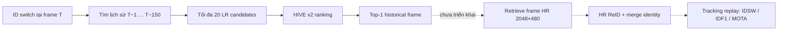

Phần đã triển khai kết thúc ở `Top-1 historical frame`. HR retrieval, identity merge và tracking replay là bước tiếp theo.

## 2. Input tensors

Với batch size mặc định `B = 8`:

| Tensor | Shape | Nội dung |
|---|---:|---|
| `target_crop` | `[B, 3, 128, 64]` | Target tại switch frame `T` |
| `old_crops` | `[B, 5, 3, 128, 64]` | Tối đa 5 crop của old track |
| `old_mask` | `[B, 5]` | Old-history slot hợp lệ |
| `candidate_crops` | `[B, 20, 3, 128, 64]` | Tối đa 20 historical candidates |
| `candidate_mask` | `[B, 20]` | Candidate slot hợp lệ |
| `competitor_crops` | `[B, 5, 3, 128, 64]` | History của predicted ID mới |
| `competitor_mask` | `[B, 5]` | Competitor slot hợp lệ |
| `metadata` | `[B, 20, 3]` | `age`, `age²`, `log_age` |
| `labels` | `[B, 20]` | Positive/negative khi training |

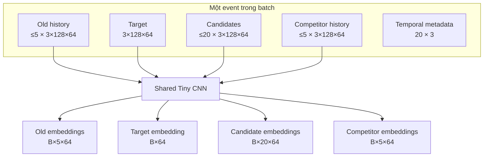

Các slot thiếu được padding bằng zero. Mask đảm bảo padded crops không được encode và không tham gia ranking.

## 3. LR crop preprocessing

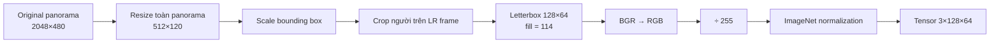

Không crop người ở HR rồi resize crop xuống LR. Toàn panorama được resize trước để mô phỏng đúng dữ liệu edge.

## 4. Shared Tiny Appearance Encoder

Mọi old, target, candidate và competitor crop dùng chung một CNN.

```mermaid
flowchart LR
    X["3×128×64"] --> C0["Conv 3×3 s2<br/>3→16"]
    C0 --> S0["16×64×32"]
    S0 --> D1["DS Block s2<br/>16→24"]
    D1 --> S1["24×32×16"]
    S1 --> D2["DS Block s2<br/>24→32"]
    D2 --> S2["32×16×8"]
    S2 --> D3["DS Block s2<br/>32→48"]
    D3 --> S3["48×8×4"]
    S3 --> D4["DS Block s2<br/>48→64"]
    D4 --> S4["64×4×2"]
    S4 --> P["AdaptiveAvgPool"]
    P --> V["64×1×1"]
    V --> F["Flatten + Dropout 0.2"]
    F --> L["Linear 64→64"]
    L --> N["L2 normalize"]
    N --> Z["Embedding ∈ R⁶⁴"]
```

Mỗi Depthwise-Separable Block:

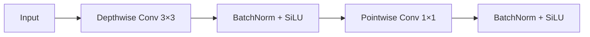

| CNN layer | Output của một crop |
|---|---:|
| Input | `[3,128,64]` |
| Conv `3×3`, stride 2 | `[16,64,32]` |
| DS `16→24`, stride 2 | `[24,32,16]` |
| DS `24→32`, stride 2 | `[32,16,8]` |
| DS `32→48`, stride 2 | `[48,8,4]` |
| DS `48→64`, stride 2 | `[64,4,2]` |
| Adaptive average pooling | `[64,1,1]` |
| Linear + L2 normalization | `[64]` |

## 5. Target-conditioned old-history attention

Với old embedding `hᵢ ∈ R⁶⁴` và target embedding `t ∈ R⁶⁴`:

```text
xᵢ = concat(hᵢ, t, |hᵢ − t|) ∈ R¹⁹²
aᵢ = W₂ tanh(W₁xᵢ + b₁) + b₂
αᵢ = masked_softmax(aᵢ)
old = Σᵢ αᵢhᵢ ∈ R⁶⁴
```

Ma trận attention:

```text
W₁ ∈ R⁶⁴ˣ¹⁹²
W₂ ∈ R¹ˣ⁶⁴
```

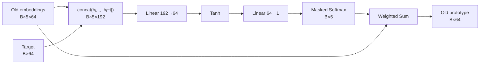

Competitor history dùng một attention aggregator khác nhưng có cùng cấu trúc, tạo competitor prototype `[B,64]`.

## 6. Candidate Relation Encoder

Với mỗi candidate `c`, old prototype `o` và target `t`, model tạo vector:

```text
r₀ = concat(
    o, t, c,
    |o−t|, |o−c|, |t−c|,
    o⊙t, o⊙c, t⊙c,
    cos(o,t), cos(o,c), cos(t,c)
)
```

Trong đó `⊙` là element-wise product.

```text
9 × 64 + 3 cosine values = 579 dimensions
r₀ shape = [B,20,579]
```

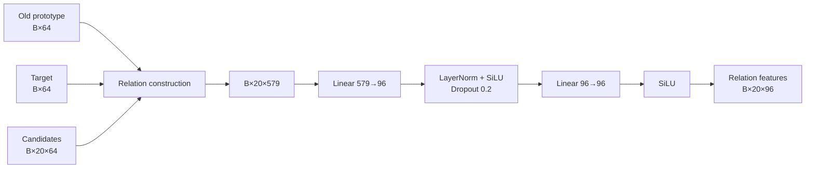

Các ma trận:

```text
Wrelation₁ ∈ R⁹⁶ˣ⁵⁷⁹
Wrelation₂ ∈ R⁹⁶ˣ⁹⁶
```

## 7. Temporal Metadata Encoder

Với candidate cách switch `s` giây:

```text
age     = clip(s / 5, 0, 1)
age²    = age × age
log_age = log(1+s) / log(1+5)
```

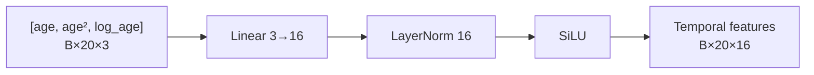

```text
Wmetadata ∈ R¹⁶ˣ³
```

## 8. Competing Hypothesis Encoder

Với competitor prototype `u`:

```text
q₀ = concat(
    u,
    |c−u|,
    c⊙u,
    cos(c,u),
    cos(t,u),
    competitor_available
)
```

```text
3 × 64 + 3 = 195 dimensions
q₀ shape = [B,20,195]
```

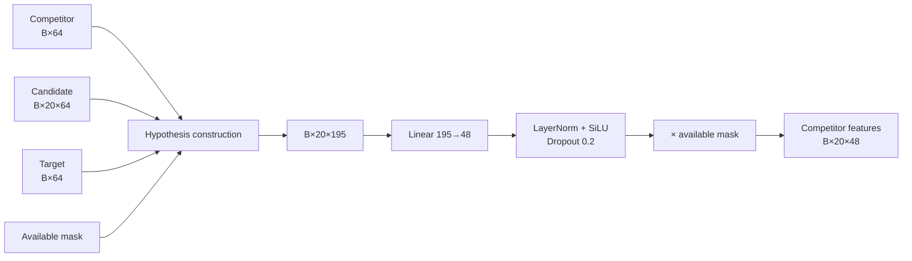

```text
Wcompetitor ∈ R⁴⁸ˣ¹⁹⁵
```

Nếu competitor history không tồn tại, toàn bộ nhánh này trả về zero.

## 9. Feature fusion và ranking head

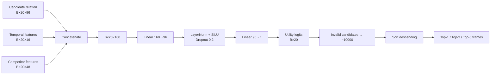

Feature fusion:

```text
96 relation + 16 temporal + 48 competitor = 160 dimensions
```

Scorer matrices:

```text
Wscore₁ ∈ R⁹⁶ˣ¹⁶⁰
Wscore₂ ∈ R¹ˣ⁹⁶
```

Raw logits được dùng để ranking. Probability chỉ dùng cho classification/request threshold:

```text
probability = sigmoid(logit)
```

## 10. End-to-end tensor flow

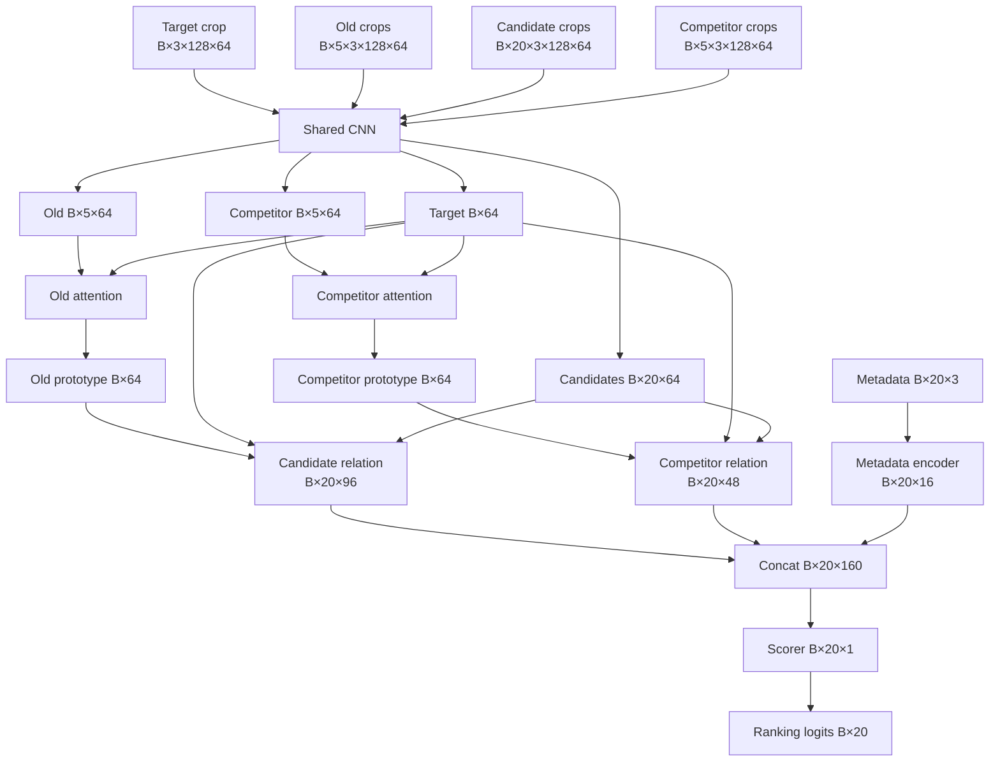

## 11. Training loss

Label của mỗi candidate:

```text
1 = candidate thuộc đúng GT identity
0 = candidate thuộc người khác hoặc unmatched
```

### Weighted BCE

```text
Lcls = BCEWithLogits(score, label)
```

Positive weight được tính tự động từ train set, hiện khoảng `2.253`.

### Event-normalized RankNet

Với positive score `s⁺` và negative score `s⁻` trong cùng event:

```text
Lpair = softplus(−(s⁺−s⁻))
      = log(1 + exp(s⁻−s⁺))
```

Loss buộc `s⁺ > s⁻`. Các pairs được average trong từng event rồi mới average giữa events.

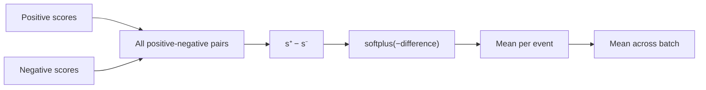

Loss tổng:

```text
L = 1.0 × Lcls + 0.5 × Lrank
```

Teacher/margin loss hiện bị tắt: `lambda_margin = 0`.

## 12. Parameter count

| Module | Registered parameters |
|---|---:|
| Shared appearance CNN | 12,040 |
| Old + competitor attention | 24,962 |
| Simple appearance branch | 18,720 |
| Candidate relation encoder | 65,184 |
| Competitor relation encoder | 9,504 |
| Metadata encoder | 96 |
| Final scorer | 15,745 |
| **Total registered** | **146,251** |

`hive_full` dùng `CandidateRelationEncoder`, nhưng code vẫn khởi tạo `SimpleAppearanceRelation`. Vì vậy 18,720 parameters của simple branch được đăng ký nhưng không đi qua forward path của `hive_full`. Forward path thực tế dùng khoảng `127,531` parameters.

## 13. Kết quả hiện tại

Held-out test gồm 92 ID-switch events:

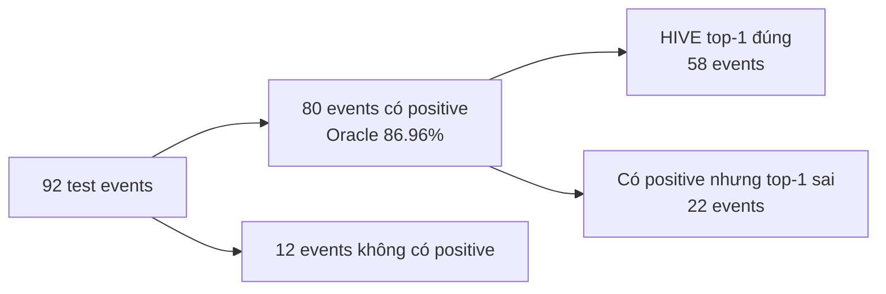

| Phương pháp | Correct top-1 | Success@1 |
|---|---:|---:|
| Nearest historical frame | 25/92 | 27.17% |
| LR proposal order | 48/92 | 52.17% |
| **HIVE v2** | **58/92** | **63.04%** |
| Candidate-pool oracle | 80/92 | 86.96% |

| HIVE metric | Kết quả |
|---|---:|
| Success@1 | 63.04% |
| Success@3 | 78.26% |
| Success@5 | 83.70% |
| MRR | 72.19% |
| NDCG@5 | 68.97% |
| Model latency | 0.815 ms/event |

So với nearest-frame, HIVE chọn đúng thêm 33 events. So với LR proposal order, HIVE chọn đúng thêm 10 events.

Kết quả này đo khả năng **chọn đúng historical evidence**. Nó chưa phải số ID switches đã được sửa, vì HR ReID, identity merge và tracking replay chưa được triển khai.

## 14. Source files

- `models/appearance_encoder.py`: Tiny CNN và attention aggregator.
- `models/hypothesis_encoder.py`: candidate relation và competing hypothesis.
- `models/hive.py`: feature fusion và ranking head.
- `datasets/dataset.py`: event tensors và masks.
- `datasets/preprocessing.py`: LR reconstruction, letterbox và temporal metadata.
- `losses/ranking_losses.py`: BCE và RankNet loss.
- `configs/hive_history_v2.yaml`: cấu hình HIVE v2 hiện tại.
